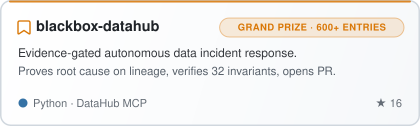
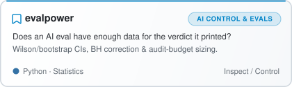
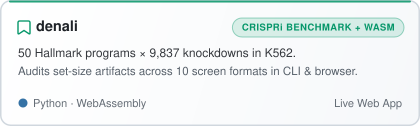
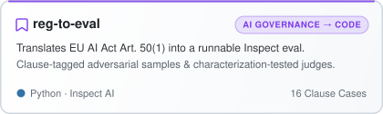

  

<h2 align="center">Hi, I'm Alex</h2>

  <samp>AI Safety &amp; Student Researcher @ UC Berkeley</samp>

  <picture>
    <source media="(prefers-color-scheme: dark)" srcset="./assets/pills-dark.svg" />
    
  </picture>

I build **statistical checks for AI evaluations**, **deterministic verification gates around autonomous agents**, and **empirical tools in computational biology** — keeping negative results, calibration intervals, and abstentions in plain sight.

- 🦦 **Core question:** What does the evidence actually support once a model, a genetic screen, or a sensor hands back a confident answer?
- 🏆 **Recent highlight:** **[BlackBox](https://github.com/alejandro-publius/blackbox-datahub)** won the **Grand Prize** at the 2026 Build with DataHub Agent Hackathon *(600+ entries)*.
- 🔬 **Open source:** Contributing evals, power analysis, and genomics fixes to **[inspect_evals](https://github.com/UKGovernmentBEIS/inspect_evals)**, **[control-arena](https://github.com/UKGovernmentBEIS/control-arena)**, **[inspect_petri](https://github.com/meridianlabs-ai/inspect_petri)**, and **[scverse/anndata](https://github.com/scverse/anndata)**.

### Spotlight

  <a href="https://github.com/alejandro-publius/blackbox-datahub"><picture><source media="(prefers-color-scheme: dark)" srcset="./assets/card-blackbox-dark.svg" /></picture></a>&nbsp;
  <a href="https://github.com/alejandro-publius/evalpower"><picture><source media="(prefers-color-scheme: dark)" srcset="./assets/card-evalpower-dark.svg" /></picture></a>

  <a href="https://github.com/alejandro-publius/denali"><picture><source media="(prefers-color-scheme: dark)" srcset="./assets/card-denali-dark.svg" /></picture></a>&nbsp;
  <a href="https://github.com/alejandro-publius/reg-to-eval"><picture><source media="(prefers-color-scheme: dark)" srcset="./assets/card-reg-to-eval-dark.svg" /></picture></a>

  <samp>
    more builds &amp; live demos:
    <a href="https://github.com/alejandro-publius/faithful">faithful</a> ·
    <a href="https://github.com/alejandro-publius/life-after-code">night-orders</a> ·
    <a href="https://github.com/alejandro-publius/tideline">tideline</a> ·
    <a href="https://github.com/alejandro-publius/model-citizen-final">model-citizen</a> ·
    <a href="https://alejandro-publius.github.io/dosedna/">dosedna</a> ·
    <a href="https://alejandro-publius.github.io/cowboys-vs-wizards/">cowboys-vs-wizards</a>
  </samp>

  <picture>
    <source media="(prefers-color-scheme: dark)" srcset="./assets/tide-divider-dark.svg" />
    
  </picture>

